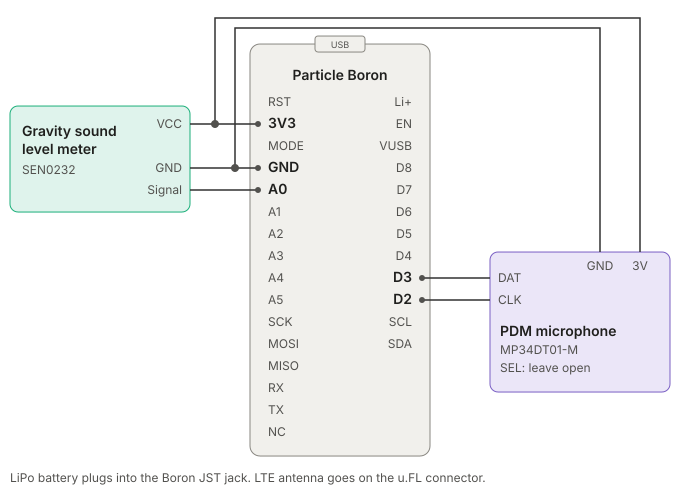

# Train Horn Monitor

Firmware for a network of identical sound monitoring nodes at a rail crossing. Each node hears the crossing bell, the train horn and the train passing, and publishes one summary per train to the Particle Cloud. Four nodes at different distances from the track show how far the noise reaches into the neighborhood and whether the horn and bell timing meets FRA rules.

Design notes and the FRA rules being checked: [Design and Rules Brief](https://claude.ai/code/artifact/fa282163-9194-486d-a7fc-831afe650004).

## Hardware (per node)

| Part | Connection |
| --- | --- |
| Particle Boron (LTE) | |
| DFRobot Gravity Analog Sound Level Meter (SEN0232) | VCC to 3V3, GND, signal to **A0** |
| Adafruit PDM MEMS microphone (MP34DT01-M) | 3V to 3V3, GND, CLK to **D2**, DAT to **D3**, SEL open |
| LiPo battery | Boron JST battery jack (the Boron has no VIN pin; for solar, use a 5 V solar charger into the USB port) |



The Gravity meter gives calibrated dB(A). The microphone is only used to tell the bell from the horn from the train, by frequency band and rhythm.

## How detection works

- **Ambient:** L90 (the level exceeded 90% of the time) of 1-second Leq values over the last 5 minutes, frozen while anything is happening.
- **Bell:** steady strikes in the 1 to 4 kHz band, at least 4 in a row with even spacing between 150 ms and 1 s.
- **Horn:** tonal energy in the 250 to 800 Hz band at least 10 dB over ambient. Blasts of 1.5 s or longer count as long, and the sequence is checked for long-long-short-long.
- **Train:** at least 10 dB over ambient for 5 seconds that is not just horn or bell, ending after 5 seconds back near ambient.

All thresholds live in [`src/config.h`](src/config.h). They are starting estimates and need tuning against recordings from the real crossing.

## Published events

`crossing` (one per train, under 1 KB). Times are milliseconds relative to `t0`:

```json
{"v":1,"node":2,"dist_ft":100,"t0":1760000100,"t0_ms":304,"amb":50.0,"peak":98.0,"sel":109.6,"act":61625,
 "bell":{"s":0,"e":59408,"n":172,"iv":347},
 "horn":{"s":16701,"e":32704,"pat":true,"peak":98.0,"n":4,"more":0,
         "b":[[16701,2508],[20194,2508],[23687,1015],[25687,7017]]},
 "train":{"s":32696,"e":57696,"leq":85.2,"max":85.2}}
```

| Field | Meaning |
| --- | --- |
| `t0`, `t0_ms` | Episode start, epoch seconds plus milliseconds |
| `amb` | Ambient dB(A) before the episode |
| `peak` | Loudest 125 ms meter reading, dB(A) |
| `sel` | Sound exposure level of the whole event (bell, horn and train together), dB(A) |
| `act` | Milliseconds the event was active |
| `bell` | Start, end, strike count, mean strike interval (ms) |
| `horn` | Start, end, FRA pattern found, peak dB(A), blast count, extra sequences, blasts as `[start, duration]` |
| `train` | Start, end, Leq over the passage, loudest 1 s Leq |

`heartbeat` (every 15 minutes): `node`, `dist_ft`, `amb`, `leq` (energy average since the last heartbeat), `soc` (battery %, -1 on an Argon bench unit, which has no fuel gauge), `busy`.

## Setup

1. Flash each Boron from Particle Workbench or `particle compile boron` (the PDM library is vendored in `lib/`).
2. Set each node's ID, distance and calibration offset with the `config` cloud function, for example `node=1,dist=50,cal=0`. A bench unit adds `test=1` so its events stay out of the live record.
3. Calibrate: hold a reference sound level meter next to the node, compare against the `dba` cloud variable, and set `cal` to the difference.

## Tests

The detection pipeline has no Particle dependencies and is tested on a PC with synthetic bell, horn and train signals:

```sh
make -C test
python3 tools/bench/run_scenarios.py   # nine crossing scenarios through the detectors and FRA checks
```

CI runs these tests and compiles for Boron and Argon on every pull request. See [docs/bench-testing.md](docs/bench-testing.md) for the scenarios and for playing them at a Wi-Fi bench unit in test mode.
